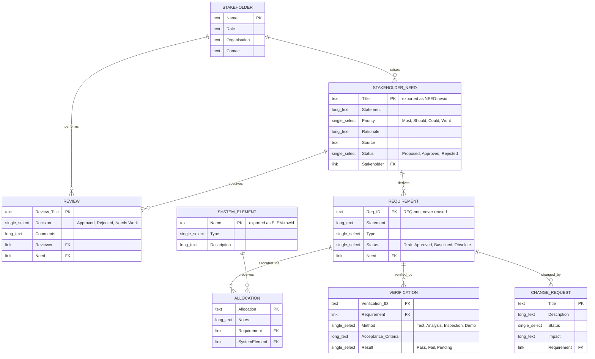
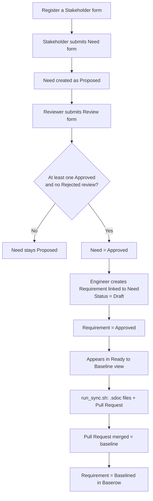
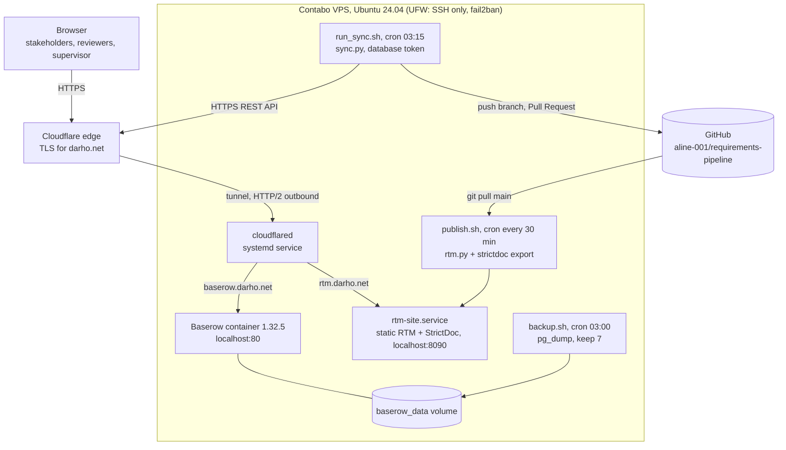
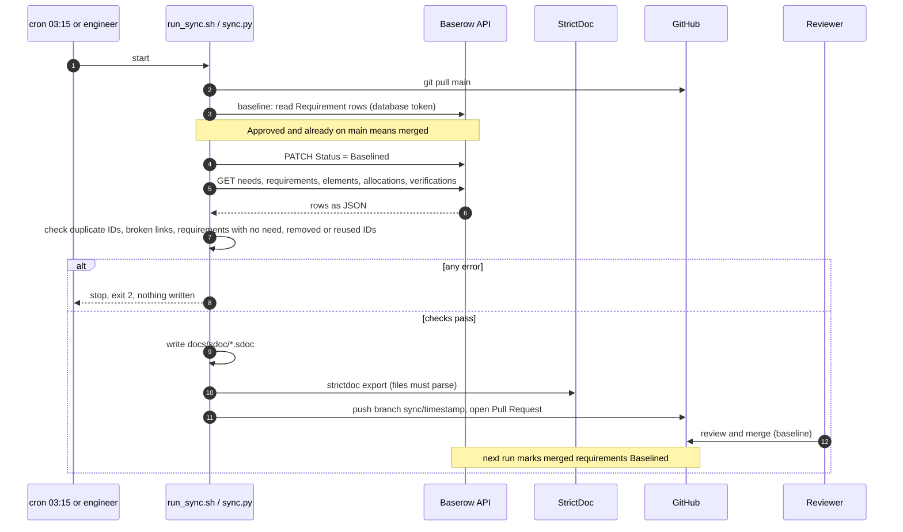
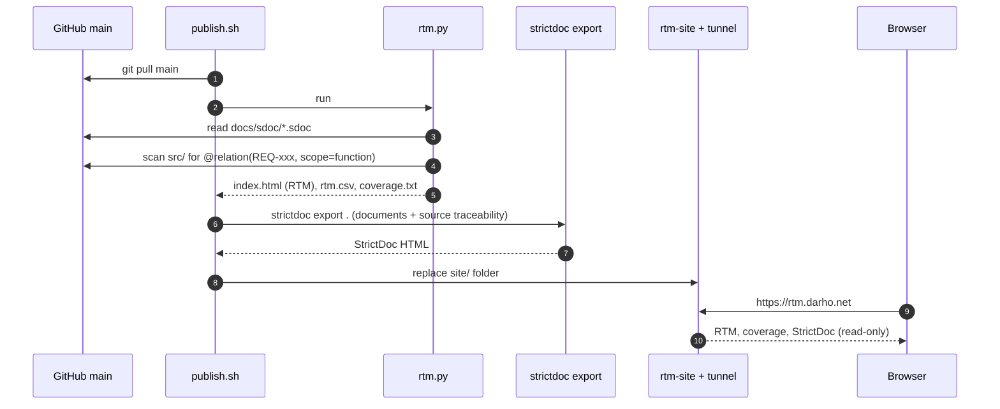
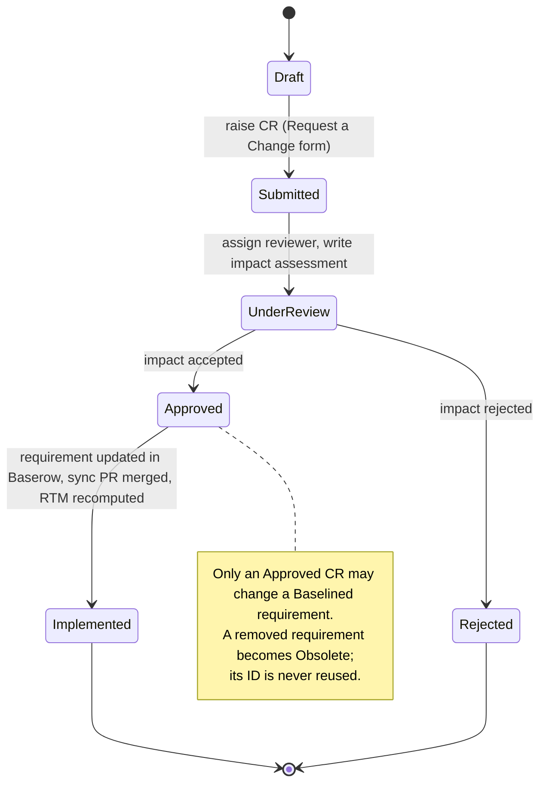
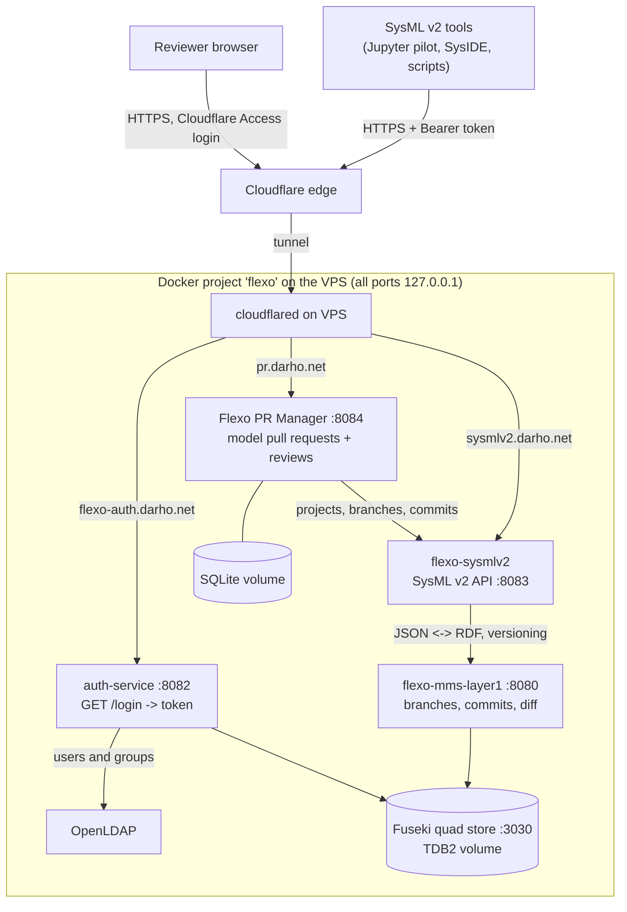
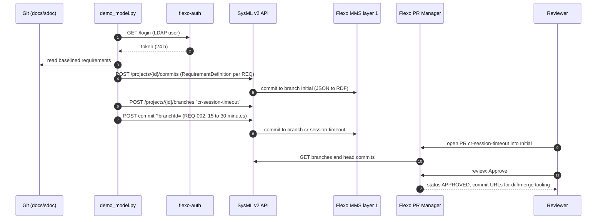

# Requirements Engineering Pipeline — Submission

**Author:** Aline ASIMWE (UR UNIPOD intern) · **Supervisor:** Patrick DARHO

## Links

| What | Link |
|---|---|
| Baserow instance (public HTTPS) | https://baserow.darho.net |
| Git repository (source of truth) | https://github.com/aline-001/requirements-pipeline |
| RTM and coverage (computed from Git) | https://rtm.darho.net |
| StrictDoc documents and traceability | https://rtm.darho.net/strictdoc/ |
| OpenMBEE SysML v2 API (for SysML v2 tools, token required) | https://sysmlv2.darho.net |
| OpenMBEE login (returns a token) | https://flexo-auth.darho.net/login |
| OpenMBEE Flexo PR Manager (model pull requests) | https://pr.darho.net |
| RTM as CSV / coverage report | https://rtm.darho.net/rtm.csv · https://rtm.darho.net/coverage.txt |
| Form: Submit a Need | https://baserow.darho.net/form/GDQAfHHbSMCHn70LQ0zECqb0sCSwsqi_4ECLqW97zfk |
| Form: Review a Need | https://baserow.darho.net/form/UOcwmCoDEnlxuVtz-oQ_G4LN-YEIBFezwjp5NYvvEI8 |
| Form: Register a Stakeholder | https://baserow.darho.net/form/FBQcO6RNOvXQ_brF45zerFWXJR3Ti6I2MvHDYjqHqV8 |
| Form: Request a Change | https://baserow.darho.net/form/Qhc8jwewHRSNyMQogMnfxWCWDp_b5DtnPwOXXu0nTh4 |
| Form: Record a Verification Result | https://baserow.darho.net/form/zk70HXuVPPuB0kQ1WcWqf2rcmJyVEW5iI5CGM8brDlQ |

The supervisor account (info.darho@gmail.com) is an admin of the workspace, so all tables and views open after login.

---

## Task 1 — Normalized Requirements Database

In the old Google Sheet, stakeholder names, sources and reviewers were retyped in every row. In Baserow (database "Requirements Engineering", id 169) each fact is stored once and referenced through link fields.

### Tables

| # | Table | ID | Fields (type) | Links |
|---|-------|-----|------------|-------|
| 1 | Stakeholder | 683 | Name (text, primary), Role (text), Organisation (text), Contact (email) | reverse links from StakeholderNeed and Review |
| 2 | SystemElement | 701 | Name (text, primary), Type (single select), Description (long text) | reverse link from Allocation |
| 3 | StakeholderNeed | 709 | Title (text, primary), Statement (long text), Priority (single select), Rationale (long text), Source (text), Status (single select: Proposed / Approved / Rejected) | → Stakeholder |
| 4 | Requirement | 703 | Req ID (text, primary), Statement (long text), Type (single select), Status (single select: Draft / Approved / Baselined / Obsolete) | → StakeholderNeed (field "Need") |
| 5 | Review | 704 | Review Title (text, primary), Decision (single select), Comments (long text) | → Stakeholder (Reviewer), → StakeholderNeed (Need) |
| 6 | Allocation | 706 | Allocation (text, primary), Notes (long text) | → Requirement, → SystemElement |
| 7 | Verification | 707 | Verification ID (text, primary), Method (single select), Acceptance Criteria (long text), Result (single select: Pass / Fail / Pending) | → Requirement |
| 8 | ChangeRequest | 708 | Title (text, primary), Description (long text), Status (single select), Impact (long text) | → Requirement |

### Why each table exists

1. **Stakeholder** — people are stored once; needs and reviews link to them instead of retyping names.
2. **SystemElement** — the parts of the system that carry requirements, so responsibility can be assigned and queried.
3. **StakeholderNeed** — what a stakeholder wants, one need per row, with priority, rationale and source. It is the root of every trace.
4. **Requirement** — the engineering "shall" statement derived from a need, with its own life cycle and a permanent ID.
5. **Review** — a decision on a need is a separate fact (who, what, why), and one need can have several reviewers.
6. **Allocation** — requirements and elements are many-to-many; one row per assignment makes "who owns this requirement" and "what does this element own" simple views.
7. **Verification** — evidence that a requirement is met (method, acceptance criteria, result); a requirement can be verified more than once.
8. **ChangeRequest** — a baselined requirement may change only through an approved request, so the request, its impact and decision are recorded on their own.

During the final check, a duplicate need-link column on Requirement ("StakeholderNeed" next to "Need") was found and removed, so each requirement's parent need is now stored exactly once. The 103 empty rows left in SystemElement by early setup scripts were also deleted.

### Entity-relationship diagram

**Code**

```text
erDiagram
    STAKEHOLDER ||--o{ STAKEHOLDER_NEED : raises
    STAKEHOLDER ||--o{ REVIEW : performs
    STAKEHOLDER_NEED ||--o{ REVIEW : receives
    STAKEHOLDER_NEED ||--o{ REQUIREMENT : derives
    REQUIREMENT ||--o{ ALLOCATION : allocated_via
    SYSTEM_ELEMENT ||--o{ ALLOCATION : receives
    REQUIREMENT ||--o{ VERIFICATION : verified_by
    REQUIREMENT ||--o{ CHANGE_REQUEST : changed_by

    STAKEHOLDER {
        text Name PK
        text Role
        text Organisation
        text Contact
    }
    STAKEHOLDER_NEED {
        text Title PK "exported as NEED-rowid"
        long_text Statement
        single_select Priority "Must, Should, Could, Wont"
        long_text Rationale
        text Source
        single_select Status "Proposed, Approved, Rejected"
        link Stakeholder FK
    }
    REVIEW {
        text Review_Title PK
        single_select Decision "Approved, Rejected, Needs Work"
        long_text Comments
        link Reviewer FK
        link Need FK
    }
    REQUIREMENT {
        text Req_ID PK "REQ-nnn, never reused"
        long_text Statement
        single_select Type
        single_select Status "Draft, Approved, Baselined, Obsolete"
        link Need FK
    }
    SYSTEM_ELEMENT {
        text Name PK "exported as ELEM-rowid"
        single_select Type
        long_text Description
    }
    ALLOCATION {
        text Allocation PK
        long_text Notes
        link Requirement FK
        link SystemElement FK
    }
    VERIFICATION {
        text Verification_ID PK
        link Requirement FK
        single_select Method "Test, Analysis, Inspection, Demo"
        long_text Acceptance_Criteria
        single_select Result "Pass, Fail, Pending"
    }
    CHANGE_REQUEST {
        text Title PK
        long_text Description
        single_select Status
        long_text Impact
        link Requirement FK
    }
```

**Diagram**



### Test data loaded

| Table | Rows |
|---|---|
| Stakeholder | Jane Smith, Keza Kelly, David Mugisha |
| SystemElement | Auth Subsystem, Login Component, Session Manager, Password Reset Service |
| StakeholderNeed | Secure user login (NEED-3), Session timeout (NEED-4), Password reset (NEED-5) |
| Requirement | REQ-001 (Obsolete, replaced by CR), REQ-002 (Approved), REQ-003 (Draft), REQ-004 (Approved, created by CR) |
| Allocation | REQ-004 → Auth Subsystem, REQ-002 → Session Manager, REQ-003 → Password Reset Service (REQ-001 → Auth Subsystem kept for history) |
| Verification | VER-001 (REQ-004), VER-002 (REQ-002), VER-003 (REQ-003) |
| ChangeRequest | Add SSO support (Implemented), Increase session timeout (Submitted), Remove password reset (Rejected) |
| Review | one review per need |

### Views

| Question | View | Table | Configuration |
|---|---|---|---|
| Which element is responsible for a requirement? | Element Responsibility | Allocation | grouped by Requirement |
| Which requirements are allocated to an element? | Requirements by Element | Allocation | grouped by SystemElement |
| Which needs have no approved review? | Needs Without Approved Review | StakeholderNeed | filtered: no Review with Decision = Approved |
| Which requirements have no verification? | Unverified Requirements | Requirement | filtered: Verification is empty |

---

## Task 2 — Stakeholder Intake Forms

All forms are published as Baserow Form views. Stakeholders, reviewers, and engineers add records through the web forms rather than editing tables directly.

### Form 1 — Submit a Need

**Table:** StakeholderNeed (709)
**Public URL:** https://baserow.darho.net/form/GDQAfHHbSMCHn70LQ0zECqb0sCSwsqi_4ECLqW97zfk

| Field | Required | Help Text |
|---|---|---|
| Title | Yes | Short summary of the need (one need per submission). |
| Statement | Yes | Describe exactly what the stakeholder requires. |
| Priority | Yes | Must = non-negotiable; Should = important; Could = nice-to-have; Wont = out of scope. |
| Rationale | Yes | Why is this needed? What problem does it solve? |
| Source | Yes | Where did this come from? Meeting, email, interview, ticket. |
| Stakeholder | Yes | Who is raising this need? |

**Hidden fields:** Status (auto-set to Proposed), Requirement and Review (reverse links).

**Submit message:** Thank you — your need has been submitted and will be reviewed.

### Form 2 — Review a Need

**Table:** Review (704)
**Public URL:** https://baserow.darho.net/form/UOcwmCoDEnlxuVtz-oQ_G4LN-YEIBFezwjp5NYvvEI8

| Field | Required | Help Text |
|---|---|---|
| Review Title | Yes | Short label for this review. |
| Decision | Yes | Approved, Rejected, or Needs Work. |
| Comments | Yes | Explain your decision. |
| Reviewer | Yes | Your name. |
| Need | Yes | Which need are you reviewing? |

**Submit message:** Thank you — your review has been recorded.

### Form 3 — Register a Stakeholder

**Table:** Stakeholder (683)
**Public URL:** https://baserow.darho.net/form/FBQcO6RNOvXQ_brF45zerFWXJR3Ti6I2MvHDYjqHqV8

| Field | Required | Help Text |
|---|---|---|
| Name | Yes | Your full name. |
| Role | Yes | Your job title or role. |
| Organisation | Yes | The organization you represent. |
| Contact | Yes | Your email address. |

**Submit message:** Thank you — your stakeholder registration has been recorded.

### Form 4 — Request a Change

**Table:** ChangeRequest (708)
**Public URL:** https://baserow.darho.net/form/Qhc8jwewHRSNyMQogMnfxWCWDp_b5DtnPwOXXu0nTh4

| Field | Required | Help Text |
|---|---|---|
| Title | Yes | Short title of the requested change. |
| Description | Yes | What change do you want and why? |
| Requirement | Yes | Which requirement does this affect? |
| Impact | Yes | Business or technical impact and effort. |

**Hidden field:** Status (auto-set to Draft).

**Submit message:** Thank you — your change request has been submitted for review.

### Form 5 — Record a Verification Result

**Table:** Verification (707)
**Public URL:** https://baserow.darho.net/form/zk70HXuVPPuB0kQ1WcWqf2rcmJyVEW5iI5CGM8brDlQ

| Field | Required | Help Text |
|---|---|---|
| Verification ID | Yes | Unique ID such as VER-001. |
| Requirement | Yes | Which requirement was verified? |
| Method | Yes | Test, Analysis, Inspection, or Demo. |
| Acceptance Criteria | Yes | What "passing" means for this verification. |
| Result | Yes | Pass, Fail, or Pending. |

**Submit message:** Thank you — the verification result has been recorded.

### Approval Rule

A StakeholderNeed becomes Approved when:

- At least one Review row exists with Decision = Approved, AND
- No Review row exists with Decision = Rejected

### Ready to Baseline View

A Grid view on the Requirement table, filtered where Status = Approved. It shows exactly the requirements that the next sync writes to Git as new baseline content. After the Pull Request is merged they become Baselined and leave the view.

### Form flow: from form submission to approved and baselined requirement

**Code**

```text
flowchart TD
    A["Register a Stakeholder form"] --> B["Stakeholder submits Need form"]
    B --> C["Need created as Proposed"]
    C --> D["Reviewer submits Review form"]
    D --> E{"At least one Approved<br/>and no Rejected review?"}
    E -->|No| F["Need stays Proposed"]
    E -->|Yes| G["Need = Approved"]
    G --> H["Engineer creates Requirement linked to Need<br/>Status = Draft"]
    H --> I["Requirement = Approved"]
    I --> J["Appears in Ready to Baseline view"]
    J --> K["run_sync.sh: .sdoc files + Pull Request"]
    K --> L["Pull Request merged = baseline"]
    L --> M["Requirement = Baselined in Baserow"]
```

**Diagram**



---

## Task 3 — Baserow on the Internet

### Docker setup with persistent storage

Baserow runs from `docker-compose.yml` (image `baserow/baserow:1.32.5`, container `baserow`). All data (PostgreSQL and uploaded files) lives in the named volume `baserow_data` mounted at `/baserow/data`, so the container can be recreated or upgraded without losing data. SMTP (Brevo) is configured for invitation and password-reset emails; the SMTP key is kept out of Git.

```yaml
services:
  baserow:
    container_name: baserow
    image: baserow/baserow:1.32.5
    restart: unless-stopped
    environment:
      BASEROW_PUBLIC_URL: "https://baserow.darho.net"
      EMAIL_SMTP: "true"
      EMAIL_SMTP_HOST: "smtp-relay.brevo.com"
      EMAIL_SMTP_PORT: "587"
      EMAIL_SMTP_USE_TLS: "true"
      EMAIL_SMTP_USER: "${BREVO_SMTP_USER}"
      EMAIL_SMTP_PASSWORD: "${BREVO_SMTP_KEY}"   # from .env, not committed
      FROM_EMAIL: "${FROM_EMAIL}"
    ports:
      - "127.0.0.1:80:80"     # only cloudflared can reach it
    volumes:
      - baserow_data:/baserow/data
volumes:
  baserow_data:
```

### Deployment Method

Cloudflare Tunnel, running as a systemd service on the Contabo VPS. The public hostname `baserow.darho.net` routes through the Cloudflare edge to the tunnel, which forwards to Baserow's Caddy proxy on `localhost:80`. The same tunnel serves `rtm.darho.net` (RTM and StrictDoc) from `localhost:8090`. QUIC is blocked on this network, so the tunnel uses HTTP/2.

**Reason for choosing Cloudflare Tunnel:**

- No manual DNS or TLS certificate configuration
- HTTPS provided automatically by Cloudflare's edge
- No inbound firewall ports required (tunnel makes outbound connections only)
- Fixed domain, unlike quick tunnels that change on restart

### Security

- HTTPS only: the only way in is the Cloudflare tunnel; Docker ports are bound to `127.0.0.1`, so Baserow is not reachable over plain HTTP on the server IP
- Public sign-up disabled in Baserow admin; new members join by email invitation only
- Separate API token for the sync script: `sync.py` uses a Baserow **database token** (stored in `.env`, never in Git), not the admin account, and it can be revoked on its own
- UFW firewall on the VPS allows only SSH (port 22)
- SSH root login disabled; fail2ban installed and running

### Backup and Restore

`backup.sh` runs `pg_dump` inside the Baserow container daily at 03:00, writes timestamped SQL to `backups/`, and prunes to keep the last 7 files. A restore was tested by piping a recent backup into a fresh `baserow_restore_test` database and confirming all tables were present.

### Deployment diagram

**Code**

```text
flowchart TB
    Browser["Browser<br/>stakeholders, reviewers, supervisor"] -->|HTTPS| CF["Cloudflare edge<br/>TLS for darho.net"]
    CF -->|"tunnel, HTTP/2 outbound"| CFD

    subgraph VPS["Contabo VPS, Ubuntu 24.04 (UFW: SSH only, fail2ban)"]
        CFD["cloudflared<br/>systemd service"]
        CFD -->|"baserow.darho.net"| Baserow["Baserow container 1.32.5<br/>localhost:80"]
        CFD -->|"rtm.darho.net"| Site["rtm-site.service<br/>static RTM + StrictDoc, localhost:8090"]
        Baserow --- Vol[("baserow_data volume")]
        Backup["backup.sh, cron 03:00<br/>pg_dump, keep 7"] --> Vol
        Sync["run_sync.sh, cron 03:15<br/>sync.py, database token"]
        Publish["publish.sh, cron every 30 min<br/>rtm.py + strictdoc export"] --> Site
    end

    Sync -->|"HTTPS REST API"| CF
    Sync -->|"push branch, Pull Request"| Git[("GitHub<br/>aline-001/requirements-pipeline")]
    Git -->|"git pull main"| Publish
```

**Diagram**



---

## Task 4 — Sync to StrictDoc

### Sync Script

`sync/sync.py` (Python standard library only) reads the Baserow REST API over HTTPS with the database token and writes four StrictDoc 0.30 documents to `docs/sdoc/`. Only approved needs are exported; of the requirements, Approved ones are written as new baseline content, Baselined ones are kept, and Obsolete ones are kept so their IDs stay reserved. Draft requirements stay in Baserow.

| File | Node type | Relations |
|---|---|---|
| `needs.sdoc` | `[NEED]` (UID, STATUS, TITLE, STATEMENT, PRIORITY, STAKEHOLDER, SOURCE, RATIONALE) | — |
| `requirements.sdoc` | `[REQUIREMENT]` (UID, STATUS, STATEMENT) grouped in a section per need | Parent → NEED |
| `elements.sdoc` | `[ELEMENT]` (UID, TITLE, STATEMENT) | Parent → REQUIREMENT, role Implements |
| `verification.sdoc` | `[VERIFICATION]` (UID, TITLE, METHOD, ACCEPTANCE_CRITERIA, RESULT) | Parent → REQUIREMENT, role Verifies |

StrictDoc 0.30 no longer accepts `[SECTION]` blocks and checks every field against a grammar, in a fixed order. Each generated file therefore declares its own `[GRAMMAR]` and uses `[[SECTION]]` … `[[/SECTION]]`. This replaced the earlier one-file-per-need layout in `docs/generated/`, which StrictDoc could not parse.

### Example: requirements.sdoc (generated, grammar block omitted)

```text
[[SECTION]]
TITLE: NEED-3: Secure user login

[REQUIREMENT]
UID: REQ-004
STATUS: Approved
STATEMENT: The system shall authenticate users via SSO
RELATIONS:
- TYPE: Parent
  VALUE: NEED-3

[[/SECTION]]

[[SECTION]]
TITLE: NEED-4: Session timeout

[REQUIREMENT]
UID: REQ-002
STATUS: Approved
STATEMENT: The system shall expire idle sessions after 15 minutes of inactivity.
RELATIONS:
- TYPE: Parent
  VALUE: NEED-4

[[/SECTION]]

[[SECTION]]
TITLE: Obsolete requirements

[REQUIREMENT]
UID: REQ-001
STATUS: Obsolete
STATEMENT: The system shall authenticate users via username and password.
RELATIONS:
- TYPE: Parent
  VALUE: NEED-3

[[/SECTION]]
```

### Error Handling

The sync stops with exit code 2 and writes nothing when it finds:

| Check | Example message |
|---|---|
| Broken link | `BROKEN LINK: REQ-002 -> NEED-4 is not Approved (status "Proposed")` |
| Duplicate ID | `DUPLICATE ID: REQ-002 is used by Requirement rows 2 and 9` |
| Requirement with no need | `NO NEED: REQ-004 is not linked to any stakeholder need` |
| ID deleted instead of made Obsolete | `REMOVED: REQ-002 is in Git but no longer exported. Set it to Obsolete instead of deleting it.` |
| Obsolete ID reused | `ID REUSE: REQ-001 is Obsolete in Git and may not be reused (now Approved).` |

After writing the files, `run_sync.sh` runs `strictdoc export`; if StrictDoc rejects them, nothing is pushed.

### Manual and Scheduled Run

- **Manual:** `./run_sync.sh` (or `python3 sync/sync.py check` to validate without writing)
- **Scheduled:** crontab entry runs `run_sync.sh` at 03:15 daily

Each run: (1) pulls `main` and marks requirements already merged there as Baselined in Baserow, (2) exports and validates, (3) if anything changed, pushes a `sync/<timestamp>` branch and opens a Pull Request. **The merged Pull Request is the baseline.**

### Sync sequence: Baserow → script → Git → Baserow

**Code**

```text
sequenceDiagram
    autonumber
    participant Cron as cron 03:15 or engineer
    participant Sync as run_sync.sh / sync.py
    participant API as Baserow API
    participant SD as StrictDoc
    participant Git as GitHub
    participant Rev as Reviewer

    Cron->>Sync: start
    Sync->>Git: git pull main
    Sync->>API: baseline: read Requirement rows (database token)
    Note over Sync,API: Approved and already on main means merged
    Sync->>API: PATCH Status = Baselined
    Sync->>API: GET needs, requirements, elements, allocations, verifications
    API-->>Sync: rows as JSON
    Sync->>Sync: check duplicate IDs, broken links, requirements with no need, removed or reused IDs
    alt any error
        Sync-->>Cron: stop, exit 2, nothing written
    else checks pass
        Sync->>Sync: write docs/sdoc/*.sdoc
        Sync->>SD: strictdoc export (files must parse)
        Sync->>Git: push branch sync/timestamp, open Pull Request
        Rev->>Git: review and merge (baseline)
        Note over Git,API: next run marks merged requirements Baselined
    end
```

**Diagram**



---

## Task 5 — Traceability, Verification and RTM

Git is the source of truth. Traceability, the RTM and the coverage report are computed from the repository by `rtm.py` and `strictdoc export`, run by `publish.sh`; nothing is typed by hand.

### Repository structure

```text
docs/sdoc/            needs, requirements, elements, verification (.sdoc, generated by sync.py)
src/auth.py           implementation; functions tagged with @relation
strictdoc_config.py   StrictDoc project config (documents + source traceability)
sync/sync.py          Baserow -> .sdoc
run_sync.sh           sync -> StrictDoc check -> Pull Request
rtm.py                RTM (index.html, rtm.csv) + coverage.txt
publish.sh            builds site/ = RTM + StrictDoc export, served at rtm.darho.net
```

### Trace in StrictDoc: need → requirement → element → code → verification

Published at **https://rtm.darho.net/strictdoc/**.

- **Need → requirement:** each `[REQUIREMENT]` has `Parent: NEED-n`.
- **Requirement → element:** each `[ELEMENT]` has `Parent: REQ-nnn`, role *Implements*.
- **Requirement → code:** StrictDoc's source traceability (enabled in `strictdoc_config.py`) reads the `@relation` markers in `src/` and links each requirement to its function.
- **Requirement → verification:** each `[VERIFICATION]` has `Parent: REQ-nnn`, role *Verifies*.

Open *System Requirements* and select a requirement to see its parent need, implementing element, source function and verification together; the *Traceability* and *Deep traceability* screens show the whole chain.

### @relation Tags

Functions in `src/auth.py` carry the StrictDoc marker in their docstring:

| Function | Marker | Requirement |
|---|---|---|
| `login` | `@relation(REQ-001, scope=function)` | REQ-001 (Obsolete, kept for audit) |
| `enforce_session_timeout` | `@relation(REQ-002, scope=function)` | REQ-002 |
| `login_via_sso` | `@relation(REQ-004, scope=function)` | REQ-004 |
| `reset_password` | no marker yet | implements REQ-003, still Draft; StrictDoc rejects tags to IDs that are not in the baseline, so it is tagged once REQ-003 is approved |

### Verification records

Recorded through the *Record a Verification Result* form, exported to `verification.sdoc` and shown in StrictDoc and the RTM.

| ID | Requirement | Method | Result |
|---|---|---|---|
| VER-001 | REQ-004 | Test | Pass |
| VER-002 | REQ-002 | Test | Pending |
| VER-003 | REQ-003 (Draft, not yet exported) | — | — |

Acceptance criteria for each record are in `docs/sdoc/verification.sdoc` and on the StrictDoc *Verification Records* page.

### RTM (one row per requirement)

Published at **https://rtm.darho.net** (also as `rtm.csv`).

| Requirement | Status | Need | Element | Code | Verification | Result |
|---|---|---|---|---|---|---|
| REQ-001 | Obsolete | NEED-3 Secure user login | ELEM-3 Auth Subsystem | src/auth.py:login | — | not counted (Obsolete) |
| REQ-002 | Approved | NEED-4 Session timeout | ELEM-7 Session Manager | src/auth.py:enforce_session_timeout | VER-002 | Pending |
| REQ-004 | Approved | NEED-3 Secure user login | ELEM-3 Auth Subsystem | src/auth.py:login_via_sso | VER-001 | Pass |

### Coverage Report

From https://rtm.darho.net/coverage.txt:

```text
Stakeholder needs                        3
Requirements (rows in RTM)               3
  active (excluding Obsolete)            2
  obsolete                               1

Gaps (active requirements only)
  no need                                0
  no allocation to an element            0
  no code link                           0
  no verification                        0

Verification pass rate                   1/2 = 50.0%
  (a requirement passes when it has at least one verification and all of them are Pass)

Warnings
  needs with no requirement              1   NEED-5
  code tags to unknown IDs               0
  code still tagged to Obsolete IDs      1   REQ-001
```

The pass rate is 50% because VER-002 (REQ-002) is still Pending. NEED-5 has no exported requirement because REQ-003 is still Draft.

### Published RTM

https://rtm.darho.net is served read-only from the VPS (`rtm-site.service` on `localhost:8090`, exposed through the Cloudflare tunnel). `publish.sh` rebuilds it from `main` every 30 minutes. The StrictDoc editing server is not exposed, because Git is the only place requirements change.

### RTM computation and publication sequence

**Code**

```text
sequenceDiagram
    autonumber
    participant Git as GitHub main
    participant Pub as publish.sh
    participant RTM as rtm.py
    participant SD as strictdoc export
    participant Web as rtm-site + tunnel
    participant User as Browser

    Pub->>Git: git pull main
    Pub->>RTM: run
    RTM->>Git: read docs/sdoc/*.sdoc
    RTM->>Git: scan src/ for @relation(REQ-xxx, scope=function)
    RTM-->>Pub: index.html (RTM), rtm.csv, coverage.txt
    Pub->>SD: strictdoc export . (documents + source traceability)
    SD-->>Pub: StrictDoc HTML
    Pub->>Web: replace site/ folder
    User->>Web: https://rtm.darho.net
    Web-->>User: RTM, coverage, StrictDoc (read-only)
```

**Diagram**



---

## Task 6 — Change Requests

A baselined requirement changes only through an approved change request. A removed requirement is set to Obsolete and its ID is never reused; `sync.py` enforces both (the `REMOVED` and `ID REUSE` errors above).

### Change-request state diagram

**Code**

```text
stateDiagram-v2
    [*] --> Draft
    Draft --> Submitted: raise CR (Request a Change form)
    Submitted --> UnderReview: assign reviewer, write impact assessment
    UnderReview --> Approved: impact accepted
    UnderReview --> Rejected: impact rejected
    Approved --> Implemented: requirement updated in Baserow, sync PR merged, RTM recomputed
    Rejected --> [*]
    Implemented --> [*]
    note right of Approved
        Only an Approved CR may change a Baselined requirement.
        A removed requirement becomes Obsolete;
        its ID is never reused.
    end note
```

**Diagram**



### Impact assessment — CR "Add SSO support"

| Item | Assessment |
|---|---|
| Request | Replace username/password login with single sign-on. |
| Affected need | NEED-3 Secure user login (unchanged, still valid). |
| Affected requirements | REQ-001 (username/password) → **Obsolete**, ID kept and never reused. New **REQ-004** "The system shall authenticate users via SSO", parent NEED-3. |
| Affected elements | Auth Subsystem: allocation moves from REQ-001 to REQ-004. |
| Affected code | New `login_via_sso()` tagged REQ-004; `login()` stays tagged to the Obsolete REQ-001 for audit. |
| Verification | New VER-001 (Test) for REQ-004. |
| Other requirements | REQ-002 session timeout: not affected. REQ-003 password reset: not affected. |
| Risk | Identity-provider outage blocks login; keep one administrator account outside SSO. |
| Decision | Approved, then Implemented. |

### The change request carried end to end

| Step | Where | Result |
|---|---|---|
| 1. Request | Baserow, Request a Change form | ChangeRequest "Add SSO support" created |
| 2. Assessment and approval | Baserow ChangeRequest (Impact, Status) | impact recorded above; approved |
| 3. Requirements changed | Baserow Requirement | REQ-001 → Obsolete; REQ-004 created, linked to NEED-3, allocated to Auth Subsystem, verified by VER-001 |
| 4. Sync | `./run_sync.sh` → `docs/sdoc/` | `requirements.sdoc` shows REQ-001 in "Obsolete requirements" and REQ-004 under NEED-3 |
| 5. Git | https://github.com/aline-001/requirements-pipeline/commits/main | commit and Pull Request with the change |
| 6. RTM | https://rtm.darho.net | REQ-001 struck through as Obsolete; REQ-004 traced NEED-3 → Auth Subsystem → `login_via_sso` → VER-001 Pass |
| 7. Closed | Baserow ChangeRequest | Status Implemented |

---

## Extension — OpenMBEE Flexo MMS, SysML v2 API and PR Manager

The pipeline is extended with the OpenMBEE **Flexo** stack, all in Docker on the same VPS. Flexo MMS stores models as RDF with Git-like version control (branches, commits, diffs). The Flexo SysML v2 service exposes them through the OMG **Systems Modeling API** (REST/HTTP), so SysML v2 tools can connect. **Flexo PR Manager** records model pull requests and reviews between branches. Setup files are in `flexo/` in the repository; `flexo/FLEXO.md` has the full guide.

### Components

| Component | Image / source | Port (127.0.0.1 only) | Public address |
|---|---|---|---|
| Fuseki quad store (RDF database, TDB2 on a volume) | `atomgraph/fuseki:4.6` | 3030 | none |
| OpenLDAP (user accounts) | `bitnamilegacy/openldap:2.6.4` | none | none |
| Flexo MMS auth service | `openmbee/flexo-mms-auth-service:latest` | 8082 | https://flexo-auth.darho.net |
| Flexo MMS layer 1 (versioning core) | `openmbee/flexo-mms-layer1-service:v0.3.0` | 8080 | none |
| Flexo SysML v2 API | `openmbee/flexo-sysmlv2:v0.2.0` | 8083 | https://sysmlv2.darho.net |
| Flexo PR Manager | built from `Open-MBEE/flexo-pr-manager` @ `cd37aef` | 8084 | https://pr.darho.net |

### Flexo deployment architecture

**Code**

```text
flowchart TB
    Tools["SysML v2 tools<br/>(Jupyter pilot, SysIDE, scripts)"] -->|"HTTPS + Bearer token"| CF
    Browser["Reviewer browser"] -->|"HTTPS, Cloudflare Access login"| CF
    CF["Cloudflare edge"] -->|"tunnel"| CFD["cloudflared on VPS"]

    subgraph VPS["Docker project 'flexo' on the VPS (all ports 127.0.0.1)"]
        CFD -->|"sysmlv2.darho.net"| S2["flexo-sysmlv2<br/>SysML v2 API :8083"]
        CFD -->|"flexo-auth.darho.net"| AU["auth-service :8082<br/>GET /login -> token"]
        CFD -->|"pr.darho.net"| PR["Flexo PR Manager :8084<br/>model pull requests + reviews"]
        PR -->|"projects, branches, commits"| S2
        S2 -->|"JSON <-> RDF, versioning"| L1["flexo-mms-layer1 :8080<br/>branches, commits, diff"]
        AU -->|"users and groups"| LDAP["OpenLDAP"]
        L1 --> QS[("Fuseki quad store :3030<br/>TDB2 volume")]
        AU --> QS
        PR --- PRDB[("SQLite volume")]
    end
```

**Diagram**



### Connecting SysML v2 tools

1. Get a token (valid 24 hours) with a Flexo login: `curl -u aline https://flexo-auth.darho.net/login` returns `{"token":"eyJ..."}`.
2. Call the SysML v2 API with the header `Authorization: Bearer <token>`, for example `GET https://sysmlv2.darho.net/projects`. The standard endpoints apply: `/projects`, `/projects/{id}/branches`, `/projects/{id}/commits`, `/projects/{id}/commits/{commit}/elements`.
3. People use the PR Manager in the browser at https://pr.darho.net. It is protected by a Cloudflare Access email login; inside it, a Flexo token is pasted in Settings.

The two API addresses are not web pages: `https://sysmlv2.darho.net/` answers 404 (the API has no home page), and the API answers 401 without a token.

### Security changes compared with the OpenMBEE example setup

| OpenMBEE example (local demo) | This deployment | Reason |
|---|---|---|
| ports open on all interfaces | bound to `127.0.0.1`, public only through the Cloudflare tunnel | Docker ports bypass the UFW firewall |
| Fuseki in memory | TDB2 on a Docker volume, initial data loaded once by `init.sh` | data survives restarts |
| published sample JWT secret and admin token | random secret in `flexo/.env` (not in Git) | anyone could sign an admin token with the public secret |
| `FLEXO_AUTH` set to an admin token | empty | the SysML v2 service uses it for callers that send no token, which would give anonymous admin access |
| default LDAP users `user01/password1` | users `aline`, `patrick` with random passwords | default passwords are public |
| PR Manager open | Cloudflare Access email login, no default token | it has no login of its own and shows its default token at `/api/config` |

Checked with `flexo/smoke_test.sh --public`: login returns a token, the API gives no data without a token (HTTP 401), the API lists projects with a token, the PR Manager reaches the API, and `pr.darho.net` requires the Cloudflare login. Daily backup at 03:30 (`backup_flexo.sh`, last 7 kept).

### Demo: requirements as a SysML v2 model, change reviewed as a model pull request

`flexo/demo_model.py` takes the baselined requirements from `docs/sdoc/requirements.sdoc` (Git, the source of truth) and commits each one to the SysML v2 project **Pipeline demo** as a `RequirementDefinition`, with the requirement ID as its short name and the statement as its name. It then creates the branch **cr-session-timeout** and commits the change proposed by change request "Increase session timeout" (REQ-002: 15 to 30 minutes of inactivity).

| Item | Value |
|---|---|
| Project | Pipeline demo (`bc22979a-39b7-4fe6-a656-5f8a8e10084c`) |
| Branch `Initial` | REQ-002 and REQ-004 as RequirementDefinitions, commit `15e1b1d8-be64-4dac-b270-d2e6ca94c628` |
| Branch `cr-session-timeout` | REQ-002 changed to 30 minutes, commit `65557139-86cd-4736-9fd0-3af94fbb95dd` |
| Pull request | #1 "CR: Increase session timeout (REQ-002)", `cr-session-timeout` into `Initial`, reviewed in the PR Manager |

The PR Manager records pull requests, reviews (Approve, Request changes, Comment) and the commit URLs of both branches. The model diff and merge themselves are done by an external tool such as LemonTree, which is how OpenMBEE designed the PR Manager.

### Model change request flow: Git → Flexo → PR Manager

**Code**

```text
sequenceDiagram
    autonumber
    participant Git as Git (docs/sdoc)
    participant Demo as demo_model.py
    participant Auth as flexo-auth
    participant API as SysML v2 API
    participant Flexo as Flexo MMS layer 1
    participant PR as Flexo PR Manager
    participant Rev as Reviewer

    Demo->>Auth: GET /login (LDAP user)
    Auth-->>Demo: token (24 h)
    Demo->>Git: read baselined requirements
    Demo->>API: POST /projects/{id}/commits (RequirementDefinition per REQ)
    API->>Flexo: commit to branch Initial (JSON to RDF)
    Demo->>API: POST /projects/{id}/branches "cr-session-timeout"
    Demo->>API: POST commit ?branchId= (REQ-002: 15 to 30 minutes)
    API->>Flexo: commit to branch cr-session-timeout
    Rev->>PR: open PR cr-session-timeout into Initial
    PR->>API: GET branches and head commits
    Rev->>PR: review: Approve
    PR-->>Rev: status APPROVED, commit URLs for diff/merge tooling
```

**Diagram**



---

## README — reusing the pipeline on a new project

Full version: `README.md` in the repository.

1. **Server and Baserow:** on a Linux server with Docker, copy `docker-compose.yml`, set `BASEROW_PUBLIC_URL`, put SMTP settings in `.env`, run `docker compose up -d`.
2. **Internet access:** create a Cloudflare named tunnel, add a published route `baserow.<domain>` → `http://localhost:80`, install `cloudflared` as a service (`--protocol http2` if QUIC is blocked).
3. **Lock down:** create the admin, turn off public sign-up, invite members by email.
4. **Database:** recreate the 8 tables above (or export this workspace and import it), keep the Status options exactly, delete test rows. Create the five forms and the views.
5. **Token:** create a Baserow database token (read all tables, update Requirement), copy `.env.example` to `.env`, fill in `BASEROW_URL`, `BASEROW_TOKEN` and the new table IDs.
6. **Repository:** copy this repository, empty `docs/sdoc/`, adjust field names at the top of `sync/sync.py` if yours differ, run `python3 sync/sync.py check`. Install StrictDoc with `pipx install strictdoc`.
7. **Run:** `./run_sync.sh`, merge the Pull Request, run it again (merged requirements become Baselined). Add cron entries for `backup.sh` (03:00), `run_sync.sh` (03:15) and `publish.sh` (every 30 min).
8. **Publish:** install `deploy/rtm-site.service`, add a tunnel route `rtm.<domain>` → `http://localhost:8090`, run `./publish.sh`.
9. **Code:** tag each implementing function's docstring with `@relation(REQ-xxx, scope=function)`.
10. **OpenMBEE Flexo (optional):** in `flexo/`, run `./setup.sh` (secrets, image downloads), `docker compose up -d`, `./init.sh` (database and SysML v2 org), `./smoke_test.sh`; add tunnel routes `sysmlv2.<domain>` → `http://localhost:8083`, `flexo-auth.<domain>` → `http://localhost:8082`, `pr.<domain>` → `http://localhost:8084`, and a Cloudflare Access policy for `pr.<domain>`. See `flexo/FLEXO.md`.
