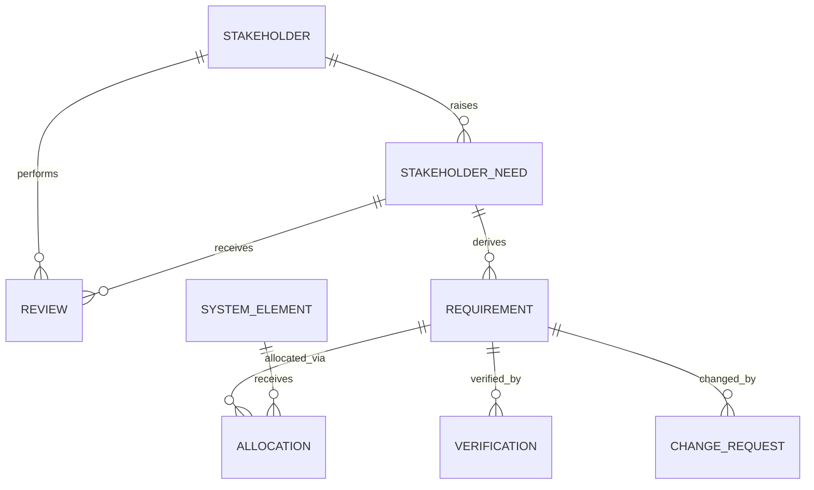
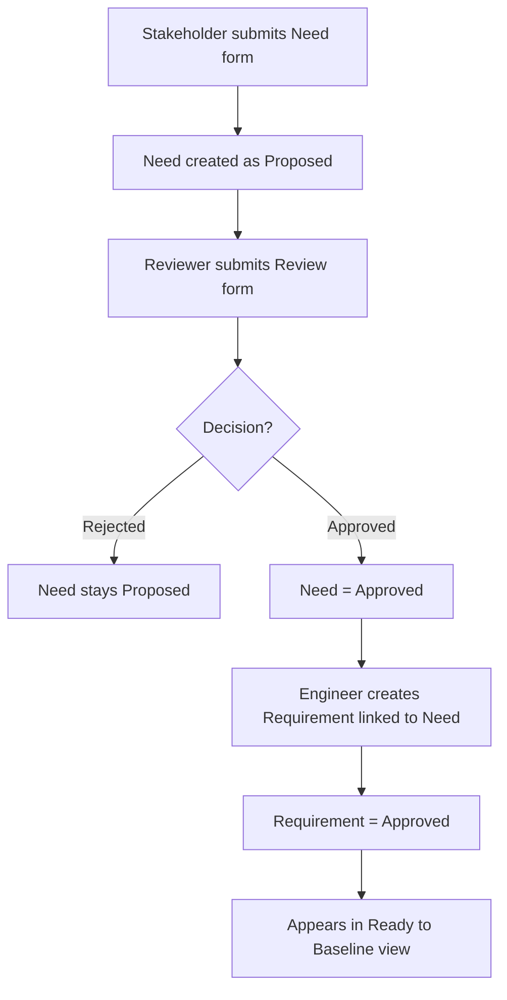
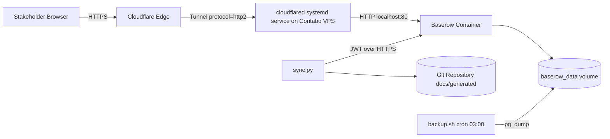
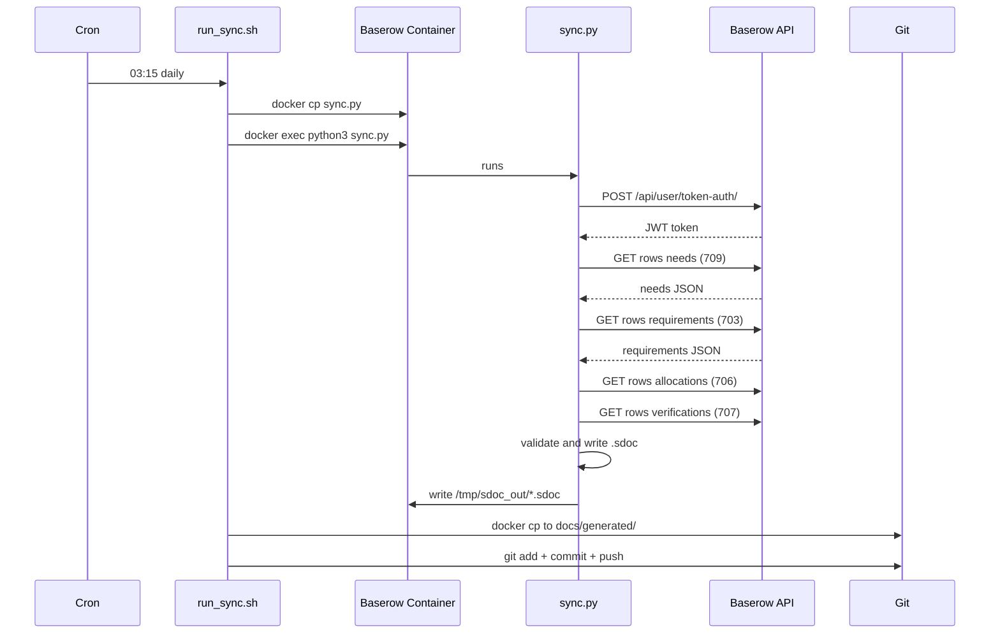
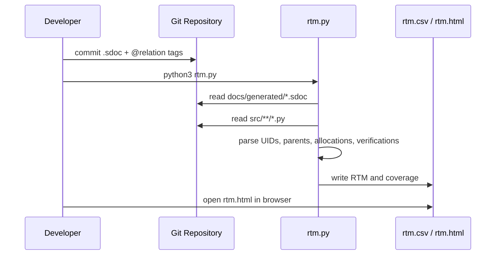
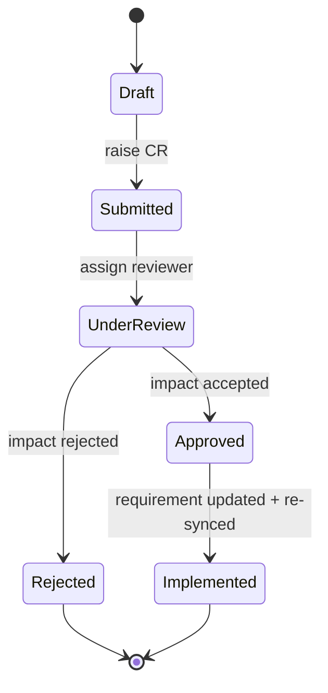

# Requirements Engineering Pipeline — Submission

## Links

- **Baserow instance (public HTTPS):** https://baserow.darho.net
- **Git repository:** https://github.com/aline-001/requirements-pipeline
- **RTM:** `rtm.html` in the repository root

---

## Task 1 — Normalized Requirements Database

### Tables

| # | Table | ID | Key Fields | Links |
|---|-------|-----|------------|-------|
| 1 | Stakeholder | 683 | Name, Role, Organisation, Contact | auto reverse |
| 2 | SystemElement | 701 | Name, Type, Description | auto reverse |
| 3 | StakeholderNeed | 709 | Title, Statement, Priority, Rationale, Status, Source | → Stakeholder |
| 4 | Requirement | 703 | Req ID, Statement, Type, Status | → StakeholderNeed |
| 5 | Review | 704 | Review Title, Decision, Comments | → Stakeholder, → StakeholderNeed |
| 6 | Allocation | 706 | Allocation, Notes | → Requirement, → SystemElement |
| 7 | Verification | 707 | Verification ID, Method, Acceptance Criteria, Result | → Requirement |
| 8 | ChangeRequest | 708 | Title, Description, Status, Impact | → Requirement |

### Views

- Element Responsibility (Allocation grouped by Requirement)
- Requirements by Element (Allocation grouped by Element)
- Needs Without Approved Review (StakeholderNeed filtered)
- Unverified Requirements (Requirement filtered)

### ERD

---

## Task 2 — Stakeholder Intake Forms

All forms are published as Baserow Form views. Stakeholders, reviewers, and engineers add records through the web forms rather than editing tables directly.

### Form 1 — Submit a Need

**Table:** StakeholderNeed (709)
**Public URL:** https://baserow.darho.net/form/GDQAfHHbSMCHn70LQ0zECqb0sCSwsqi_4ECLqW97zfk

| Field | Required | Help Text |
|---|---|---|
| Title | Yes | Short summary of the need (one need per submission). |
| Statement | Yes | Describe exactly what the stakeholder requires. |
| Priority | Yes | Must = non-negotiable; Should = important; Could = nice-to-have; Wont = out of scope. |
| Rationale | Yes | Why is this needed? What problem does it solve? |
| Source | Yes | Where did this come from? Meeting, email, interview, ticket. |
| Stakeholder | Yes | Who is raising this need? |

**Hidden fields:** Status (auto-set to Proposed), Requirement and Review (reverse links).

**Submit message:** Thank you — your need has been submitted and will be reviewed.

### Form 2 — Review a Need

**Table:** Review (704)
**Public URL:** https://baserow.darho.net/form/UOcwmCoDEnlxuVtz-oQ_G4LN-YEIBFezwjp5NYvvEI8

| Field | Required | Help Text |
|---|---|---|
| Review Title | Yes | Short label for this review. |
| Decision | Yes | Approved, Rejected, or Needs Work. |
| Comments | Yes | Explain your decision. |
| Reviewer | Yes | Your name. |
| Need | Yes | Which need are you reviewing? |

**Submit message:** Thank you — your review has been recorded.

### Form 3 — Register a Stakeholder

**Table:** Stakeholder (683)
**Public URL:** https://baserow.darho.net/form/FBQcO6RNOvXQ_brF45zerFWXJR3Ti6I2MvHDYjqHqV8

| Field | Required | Help Text |
|---|---|---|
| Name | Yes | Your full name. |
| Role | Yes | Your job title or role. |
| Organisation | Yes | The organization you represent. |
| Contact | Yes | Your email address. |

**Submit message:** Thank you — your stakeholder registration has been recorded.

### Form 4 — Request a Change

**Table:** ChangeRequest (708)
**Public URL:** https://baserow.darho.net/form/Qhc8jwewHRSNyMQogMnfxWCWDp_b5DtnPwOXXu0nTh4

| Field | Required | Help Text |
|---|---|---|
| Title | Yes | Short title of the requested change. |
| Description | Yes | What change do you want and why? |
| Requirement | Yes | Which requirement does this affect? |
| Impact | Yes | Business or technical impact and effort. |

**Hidden field:** Status (auto-set to Draft).

**Submit message:** Thank you — your change request has been submitted for review.

### Form 5 — Record a Verification Result

**Table:** Verification (707)
**Public URL:** https://baserow.darho.net/form/zk70HXuVPPuB0kQ1WcWqf2rcmJyVEW5iI5CGM8brDlQ

| Field | Required | Help Text |
|---|---|---|
| Verification ID | Yes | Unique ID such as VER-001. |
| Requirement | Yes | Which requirement was verified? |
| Method | Yes | Test, Analysis, Inspection, or Demo. |
| Acceptance Criteria | Yes | What "passing" means for this verification. |
| Result | Yes | Pass, Fail, or Pending. |

**Submit message:** Thank you — the verification result has been recorded.

### Approval Rule

A StakeholderNeed becomes Approved when:

- At least one Review row exists with Decision = Approved, AND
- No Review row exists with Decision = Rejected

### Ready to Baseline View

A Grid view on the Requirement table, filtered where Status = Approved. Shows only requirements eligible to be synced to Git.

### Form Flow Diagram

---

## Task 3 — Baserow on the Internet

### Deployment Method

Cloudflare Tunnel, running as a systemd service on the Contabo VPS. The public hostname `baserow.darho.net` routes through the Cloudflare edge to the tunnel, which forwards to Baserow's Caddy proxy on `localhost:80`.

**Reason for choosing Cloudflare Tunnel:**

- No manual DNS or TLS certificate configuration
- HTTPS provided automatically by Cloudflare's edge
- No inbound firewall ports required (tunnel makes outbound connections only)
- Fixed domain, unlike quick tunnels that change on restart

### Public URL

https://baserow.darho.net

### Security

- HTTPS only, provided by Cloudflare edge
- Public sign-up disabled in Baserow admin
- JWT authentication for the sync pipeline (not the admin account)
- UFW firewall on the VPS allows only SSH (port 22)
- fail2ban installed and running

### Backup and Restore

`backup.sh` runs `pg_dump` inside the Baserow container daily at 03:00, writes timestamped SQL to `backups/`, and prunes to keep the last 7 files. A restore was tested by piping a recent backup into a fresh `baserow_restore_test` database and confirming all tables were present.

### Deployment Diagram

---

## Task 4 — Sync to StrictDoc

### Sync Script

`sync/sync.py` authenticates via JWT (`/api/user/token-auth/`), fetches the StakeholderNeed, Requirement, Allocation, and Verification tables, then writes one `.sdoc` file per approved need. Each `.sdoc` contains the need and its linked requirements, with full `RELATIONS` blocks including Parent, AllocatedTo, and VerifiedBy.

### Error Handling

- Missing Req ID: warned and skipped
- Duplicate Req ID: fatal error
- Requirement with no need: fatal error
- Requirement links to a missing need: fatal error

### Manual and Scheduled Run

- **Manual:** `./run_sync.sh`
- **Scheduled:** crontab entry runs at 03:15 daily

### .sdoc Output

Files are written to `docs/generated/` (one per approved need). Requirements are nested under their parent need with `RELATIONS` blocks that capture the full traceability chain.

### Sync Sequence Diagram

---

## Task 5 — Traceability, Verification and RTM

### @relation Tags

Three functions tagged in `src/auth.py`:

- `login` → REQ-001
- `enforce_session_timeout` → REQ-002
- `login_via_sso` → REQ-004

### RTM

Generated by `rtm.py` from the `.sdoc` files and source code. One row per requirement.

| UID | Statement | Status | Parent Need | Allocations | Verifications | Code Link |
|-----|-----------|--------|-------------|-------------|---------------|-----------|
| REQ-004 | The system shall authenticate users via SSO | Approved | NEED-3 | Auth | VER-1 | auth.py:login_via_sso |
| REQ-002 | The system shall expire idle sessions after 15 minutes | Approved | NEED-4 | Login | VER-2 | auth.py:enforce_session_timeout |

### Coverage Report

Total stakeholder needs: 3
Total requirements: 2
Requirements with no parent need: 0
Requirements with no code link: 0
Requirements with no status: 0
Requirements with no allocation: 0
Requirements with no verification: 0
Pass rate (Approved or Baselined): 2/2 = 100.0%

### Published RTM

`rtm.html` in the repository root. Viewable in any browser.

### RTM Generation Sequence

---

## Task 6 — Change Requests

### State Diagram

