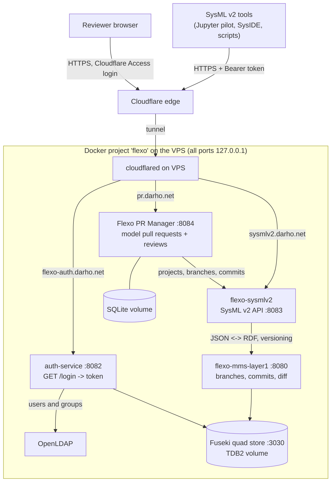

# OpenMBEE Flexo MMS + SysML v2 API + Flexo PR Manager

A Docker pipeline on the VPS that stores SysML v2 models in OpenMBEE **Flexo MMS** ("git for models": branches, commits, diffs), exposes them through the standard **SysML v2 API** so SysML v2 tools can connect, and uses **Flexo PR Manager** for model pull requests and reviews.

All components are official Open-MBEE projects:

| Component | Image / source | Port (127.0.0.1 only) | Public address |
|---|---|---|---|
| Fuseki quad store (RDF database) | `atomgraph/fuseki:4.6` | 3030 | none |
| OpenLDAP (user accounts) | `bitnamilegacy/openldap:2.6.4` | none | none |
| Flexo MMS auth service | `openmbee/flexo-mms-auth-service:latest` | 8082 | https://flexo-auth.darho.net |
| Flexo MMS layer 1 (versioning core) | `openmbee/flexo-mms-layer1-service:v0.3.0` | 8080 | none |
| Flexo SysML v2 API | `openmbee/flexo-sysmlv2:v0.2.0` | 8083 | https://sysmlv2.darho.net |
| Flexo PR Manager | built from `Open-MBEE/flexo-pr-manager` @ `cd37aef` | 8084 | https://pr.darho.net (Cloudflare Access) |

### Architecture

**Code**

```text
flowchart TB
    Tools["SysML v2 tools<br/>(Jupyter pilot, SysIDE, scripts)"] -->|"HTTPS + Bearer token"| CF
    Browser["Reviewer browser"] -->|"HTTPS, Cloudflare Access login"| CF
    CF["Cloudflare edge"] -->|"tunnel"| CFD["cloudflared on VPS"]

    subgraph VPS["Docker project 'flexo' on the VPS (all ports 127.0.0.1)"]
        CFD -->|"sysmlv2.darho.net"| S2["flexo-sysmlv2<br/>SysML v2 API :8083"]
        CFD -->|"flexo-auth.darho.net"| AU["auth-service :8082<br/>GET /login -> token"]
        CFD -->|"pr.darho.net"| PR["Flexo PR Manager :8084<br/>model pull requests + reviews"]
        PR -->|"projects, branches, commits"| S2
        S2 -->|"JSON <-> RDF, versioning"| L1["flexo-mms-layer1 :8080<br/>branches, commits, diff"]
        AU -->|"users and groups"| LDAP["OpenLDAP"]
        L1 --> QS[("Fuseki quad store :3030<br/>TDB2 volume")]
        AU --> QS
        PR --- PRDB[("SQLite volume")]
    end
```

**Diagram**



## What differs from the OpenMBEE example compose files

| Example (local demo) | Here (public server) | Why |
|---|---|---|
| Ports open on all interfaces | `127.0.0.1` only | Docker ports bypass UFW; only the tunnel is public |
| Fuseki in memory (`--file`) | TDB2 on a volume (`--tdb2 --loc`) | data survives restarts; `init.sh` loads `cluster.trig` once |
| Published sample JWT secret and a ready admin token | random secret in `.env` | the sample secret is public, so anyone could sign an admin token |
| `FLEXO_AUTH` = admin token | empty | the SysML v2 API uses `FLEXO_AUTH` for any caller who sends no token, so a public API would give anonymous admin access |
| LDAP users `user01/password1` | users from `setup.sh` with random passwords | default passwords are public |
| Fuseki heap 8 GB | 1 GB (`FUSEKI_HEAP`) | the VPS has 8 GB shared with Baserow |
| PR manager open | behind Cloudflare Access, no default token | it has no login of its own, its server fetches any address a visitor enters, and `/api/config` shows the default token |

## Install (on the VPS, from `~/requirements-pipeline/flexo`)

```bash
./setup.sh              # .env with secrets + LDAP passwords (shown once), pull images, build PR manager
docker compose up -d    # start everything
./init.sh               # load Flexo schema/policies into Fuseki, create the "sysmlv2" org
./smoke_test.sh --create-demo   # login -> token -> SysML v2 API -> PR manager; creates "Pipeline demo"
```

Cloudflare (Zero Trust → Networks → Tunnels → baserow-tunnel → Routes → Add route → Published application):

| Subdomain | Service URL |
|---|---|
| `sysmlv2` | `http://localhost:8083` |
| `flexo-auth` | `http://localhost:8082` |
| `pr` | `http://localhost:8084` |

Then Zero Trust → Access → Applications → Add → Self-hosted: domain `pr.darho.net`, policy *Allow* with the reviewers' emails (one-time PIN login). Finally `./smoke_test.sh --public`.

Backups: cron `30 3 * * *  cd $HOME/requirements-pipeline/flexo && ./backup_flexo.sh >> backups/backup.log 2>&1` (Fuseki, LDAP and PR-manager volumes, last 7 kept; restore steps at the top of the script).

## Connecting SysML v2 tools

1. Get a token (valid 24 hours) with your Flexo login:
   ```bash
   curl -u aline https://flexo-auth.darho.net/login      # -> {"token":"eyJ..."}
   ```
2. Use the SysML v2 API at **https://sysmlv2.darho.net** with the header `Authorization: Bearer <token>`:
   ```bash
   curl -H "Authorization: Bearer $TOKEN" https://sysmlv2.darho.net/projects
   ```
   ```python
   import requests
   token = requests.get("https://flexo-auth.darho.net/login", auth=("aline", "PASSWORD")).json()["token"]
   h = {"Authorization": f"Bearer {token}", "User-Agent": "sysml-client/1.0"}
   print(requests.get("https://sysmlv2.darho.net/projects", headers=h).json())
   ```
3. Any client of the OMG Systems Modeling API (REST/HTTP PSM) can use the same base URL and token: `/projects`, `/projects/{id}/branches`, `/projects/{id}/commits`, `/projects/{id}/commits/{commit}/elements`, and so on.
4. In the PR manager (https://pr.darho.net), set the API base to `http://sysmlv2-service:8080` (the default), paste the token, pick the project, and open a pull request from a source branch to a target branch. Reviews (`APPROVED`, `CHANGES_REQUESTED`, `COMMENTED`) set the PR status.

## Troubleshooting

| Symptom | Cause / fix |
|---|---|
| `error code: 1010` from a script | Cloudflare blocks default client names; send a `User-Agent` header (as in the Python example), or relax "Browser Integrity Check" for `sysmlv2.darho.net` |
| `init.sh` waits forever | `docker compose ps` and `docker compose logs --tail 50 <service>`; usually a container restarting for lack of memory, see `free -h` |
| `401`/`404` from the SysML v2 API with a token | token expired (24 h) or made with another secret; log in again |
| PR manager shows no projects | wrong token pasted, or API base changed from `http://sysmlv2-service:8080` |
| Images fail to pull | a tag was removed from Docker Hub; check https://hub.docker.com/u/openmbee and update the tag in `docker-compose.yml` |
